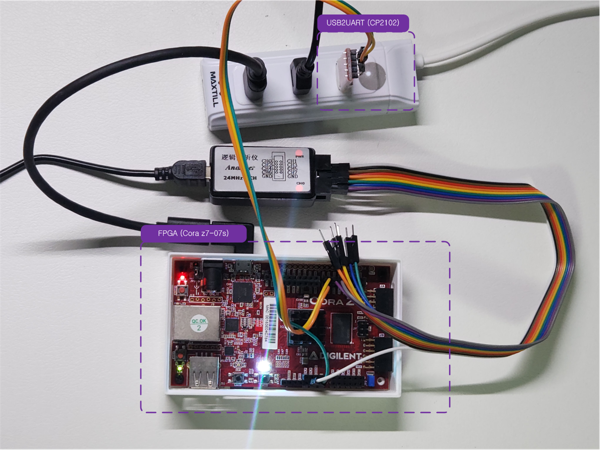
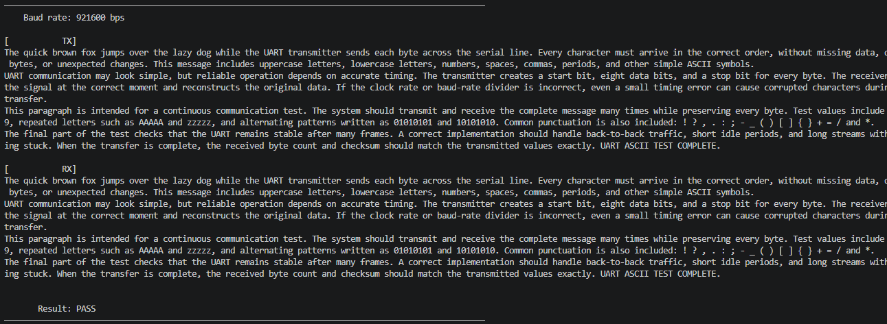

# FPGA UART

This personal project implements a SystemVerilog UART core with RX/TX logic, 16× oversampling, and a fractional baud rate generator. It covers AXI4-Lite baud rate configuration, simulation, and PC ↔ FPGA echo verification on a Cora Z7-07S.

<p align="center">
  
</p>

## Skills

- **HDL**: SystemVerilog
- **Verification**: UVM, Python (testbench)
- **Tools**: Xilinx Vivado 2025.2, Vitis 2025.2
- **FPGA**: Cora Z7-07S

## Design Results ([specifications](./UART/design-specifications.md))

- UART
    - **Supported Baud Rates**: 9,600 / 19,200 / 38,400 / 57,600 / 115,200 / 230,400 / 460,800 / 921,600 bps
    - **RX Oversampling Rate**: 16×
    - **Baud Rate Generator**: Integer or Fractional Clock Divider
- **Source clock frequency**: 60 MHz

### Resource Utilization (Synthesis)

- **Target**: `axi_UART` IP, out-of-context synthesis (Vivado 2025.2)

| Resource | Estimation | Available | Utilization |
| --- | ---: | ---: | ---: |
| LUT | 107 | 14,400 | 0.74% |
| FF | 192 | 28,800 | 0.67% |
| BUFG | 0 | 32 | 0.00% |
| LUTRAM | 0 | 6,000 | 0.00% |
| BRAM | 0 | 50 | 0.00% |

### Timing

<!-- wave image -->

## Testbench: Echo Test ([testbench](./UART/testbench/echo_testbench.md))

### Environment

- Windows 11
- **Host to FPGA**: CP2102 USB-to-UART adapter

### Result

- **Baud Rate**: 921,600 bps

<p align="center">
  
</p>

## Troubleshooting

- [Sharing the Clock Generator](./doc/troubleshooting/01-shared-clock-generator.md) · [한국어](./doc/troubleshooting/01-shared-clock-generator.ko.md)
- [Fixing Fractional Divider Carry Handling](./doc/troubleshooting/02-fractional-divider-carry.md) · [한국어](./doc/troubleshooting/02-fractional-divider-carry.ko.md)
- [Raising the Source Clock for 921,600 bps](./doc/troubleshooting/03-source-clock-frequency.md) · [한국어](./doc/troubleshooting/03-source-clock-frequency.ko.md)

## AI Usage

- **Model**: ChatGPT, GPT6.1 Sol Medium
- Code authorship

  ```text
  UART/sim/
  ├── UVM                       (AI)
  ├── UART_rx                   (AI)
  ├── UART_tx                   (Human)
  └── rx_controller             (Human)
  UART/experiments/
  └── clock_generator           (AI)
  utiles/
  ├── behavior.bat              (Human)
  ├── behavior_sim.bat          (Human)
  ├── synthesis.bat             (AI)
  ├── synthesis_sim.bat         (AI)
  ├── implementation.bat        (AI)
  └── implementation_sim.bat    (AI)
  ```
