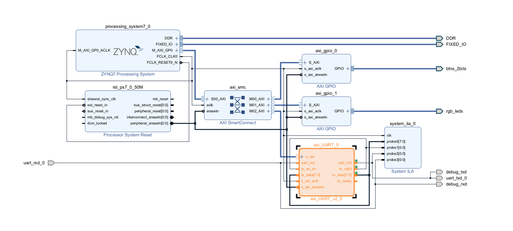

# Testbench, echo test

[README](../../README.md) · [UART specifications](../design-specifications.md)

## Environment

- **Host**: Windows 11
- **FPGA**: Cora Z7-07S
- **Host to FPGA**: CP2102 USB-to-UART adapter
- **SW**: Xilinx Vivado 2025.2, Vitis 2025.2
- **Testbench**: Python (`pyserial`)
- **Board application clock frequency**: 60 MHz

  

## Design

- **Data path**: PC → CP2102 → FPGA RX → FPGA TX → CP2102 → PC
- **PL**: Received data is connected directly to the transmitter for echo.
- **PS**: Configures baud rate through AXI4-Lite; buttons select the rate and LEDs display the selected index.

  

## Testbench

- **[main.c](./main.c)**: Baud rate selection and GPIO control
- **[testbench.py](./testbench.py)**: Sends an ASCII message and compares it with the returned message
- **Payload**: 1,464 bytes
- **PASS condition**: The received message matches the transmitted message within the polling limit.
- **Serial format**: Host 8-N-2; UART IP target 8-N-1

## Result

- **Baud rate**: 921,600 bps
- **Result**: PASS (saved hardware capture)
- **Verification scope**: ASCII message echo at the rate above

  

<!-- Add an ILA waveform to ../../doc/img/ when available. -->

## Resource utilization (Implementation of echo testbench)

- **Target**: Complete echo system, including UART, AXI infrastructure, GPIO, and ILA
- **Stage**: Fully Placed, Vivado 2025.2

| Resource | Used | Available | Utilization |
| --- | ---: | ---: | ---: |
| LUT | 2,060 | 14,400 | 14.31% |
| FF | 3,192 | 28,800 | 11.08% |
| BUFG | 3 | 32 | 9.38% |
| LUT used as memory | 108 | 6,000 | 1.80% |
| BRAM tiles | 0.5 | 50 | 1.00% |

UART IP synthesis resources are listed in the [specifications](../design-specifications.md#resource-utilization-synthesis).

<!-- Source: UART/prj_vivado/block_r1/block_r1.runs/impl_1/design_1_wrapper_utilization_placed.rpt (2026-10-17). -->

## Timing (Implementation)

- **Stage**: After routing and physical optimization
- **Fabric clock**: Approximately 60 MHz

| WNS | TNS | WHS | THS |
| ---: | ---: | ---: | ---: |
| 2.563 ns | 0.000 ns | 0.032 ns | 0.000 ns |

Values cover constrained paths; unconstrained paths remain in the report.

<!-- Source: UART/prj_vivado/block_r1/block_r1.runs/impl_1/design_1_wrapper_timing_summary_postroute_physopted.rpt (2026-10-17). -->
