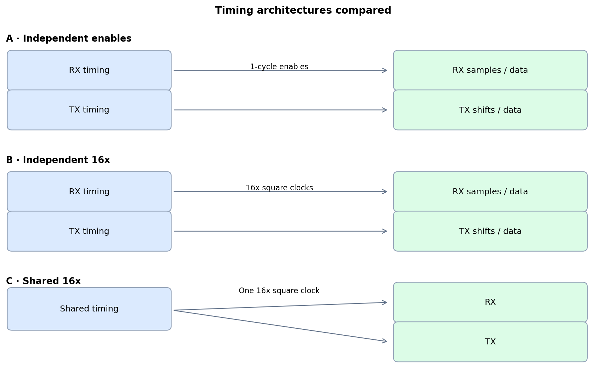
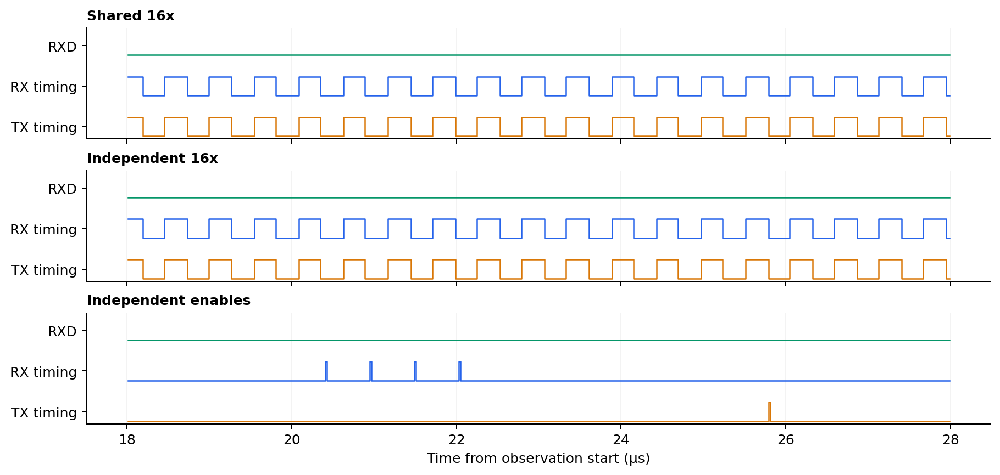
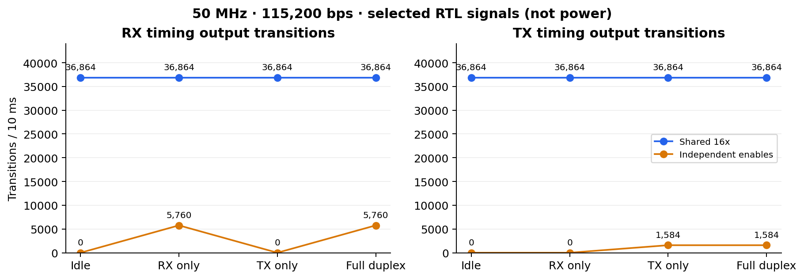

# 공용 Clock Generator로의 구조 변경

[README](../../README.md#troubleshooting) · [English](./01-shared-clock-generator.md) · [다음: 소수 분주기의 carry 처리](./02-fractional-divider-carry.ko.md)

## 설계 판단

초기에는 RX와 TX에 각각 타이밍 생성기를 두고, 샘플링이나 시프트가 필요한 시점에만 트리거를 출력하는 방식을 구상했다. RX와 TX를 독립적으로 동작시키면서 타이밍 출력의 신호 전환 횟수를 줄여 스위칭 활동을 낮추려는 의도였다. 이후 분주기 중복에 따른 자원 증가를 우려해, 전체 16× 오버샘플링 클록을 생성하는 현재의 공용 구조를 선택했다.

  

## 구조 비교

> 설계 비교를 위해 작성·측정한 자료. [RTL, 시험 조건 및 원시 결과](../../UART/experiments/clock_generator/README.md).

`xc7z007sclg400-1`에서 UART 코어만을 대상으로 세 구조를 비교했다. 입력 클록 50 MHz, 115,200 bps, 정수부·소수부 각각 16비트의 동일한 분주 설정을 사용하고, Vivado 2025.2에서 OOC 합성을 수행했다. 분주 설정 입력은 가변으로 유지했으며, AXI 레지스터와 보드 주변 회로는 제외했다.

비교용으로 새로 작성한 enable 모델은 개별 타이밍 생성기, RX의 3회 샘플 다수결 판정, 입력 클록에 동기화된 clock enable을 사용한다. 기존의 생성 클록 기반 구현과 제어 로직이 다르므로, 자원 차이는 구조 전체의 차이로 해석해야 한다.

| 구조 | LUT | FF | BUFG |
| --- | ---: | ---: | ---: |
| 공용 16× 클록 | 91 | 88 | 0 |
| 개별 16× 클록 | 91 | 88 | 0 |
| 개별 clock enable | 197 | 117 | 0 |

Vivado는 동일한 두 16× 분주기를 **34개 FF로 구성된 하나의 타이밍 회로로 병합**했다. 따라서 명시적인 공용 구조와 분주기를 중복 배치한 RTL의 합성 자원 사용량은 같았다. 이 결과만으로 공용화 자체의 면적 절감 효과를 입증할 수는 없다. 이번에 작성한 enable 모델은 더 많은 자원을 사용했다.

  

## 신호 전환 횟수와 결과

세 구조 모두 RX 단독, TX 단독, 동시 송수신 시험에서 **동작한 각 방향의 데이터 72/72바이트가 일치**했다. 데이터 누락·추가 수신·시간 초과는 없었고, 유휴 상태와 reset 확인도 통과했다.

| 10 ms 관찰 조건 | 공용 클록: RX / TX 전환 횟수 | Enable: RX / TX 전환 횟수 |
| --- | ---: | ---: |
| 유휴 상태 | 36,864 / 36,864 | 0 / 0 |
| RX 단독 | 36,864 / 36,864 | 5,760 / 0 |
| TX 단독 | 36,864 / 36,864 | 0 / 1,584 |
| 동시 송수신 | 36,864 / 36,864 | 5,760 / 1,584 |

  

RX/TX 열은 각 모듈이 사용하는 타이밍 신호의 전환 횟수다. 공용 구조에서는 두 신호가 같은 물리적 net이므로, 서로 다른 두 클록의 전환 횟수로 합산하면 안 된다. 개별 16× RTL도 모듈별로 같은 전환 횟수를 보였다. Enable 모델은 비활성 타이밍 생성기를 멈추고, RX 샘플링·판정 시점과 TX 비트 경계에서 입력 클록 한 주기 길이의 펄스를 출력한다.

이 수치는 **선택한 RTL 신호의 전환 횟수이며 소비 전력 측정값은 아니다.** 입력 클록 배포, 내부 연산, 배선 및 물리 구현의 영향은 포함하지 않는다. 공용 구조는 적은 자원을 사용하는 구현이며, enable 모델은 자원과 신호 전환 횟수 사이의 절충을 보여준다. 실제 전력 절감 효과는 입증하지 않았다. 합성 보고서에 타이밍 제약이 적용되지 않은 경로가 남아 있으므로 전체 경로의 타이밍 만족을 주장하지 않는다.
