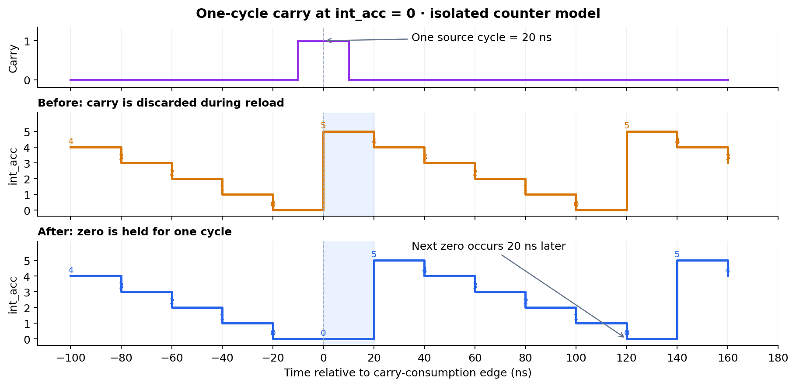
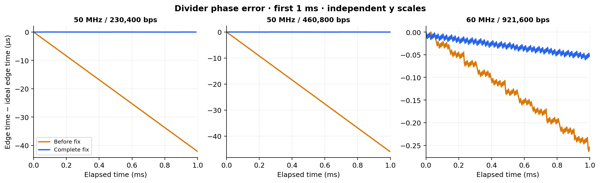

# Fixing Fractional Divider Carry Handling

[README](../../README.md#troubleshooting) · [한국어](./02-fractional-divider-carry.ko.md) · [Previous: shared generator](./01-shared-clock-generator.md) · [Next: source clock](./03-source-clock-frequency.md)

## Problem and investigation

During development, incorrect returned characters appeared at 230,400 bps and above. Hardware Monitor showed that the internal RX output was already incorrect, narrowing the investigation to reception. Simulation waveforms then showed trigger timing progressively departing from the expected timing.

The fractional accumulator produces a **one-source-cycle carry pulse** in the tested configurations. When that pulse coincided with `int_acc == 0`, the counter's reload branch assigned `div_int` without consuming the carry. The pulse disappeared on the next cycle, so that fractional correction was lost.

Each missed correction removed a required waiting cycle. Repeated omissions shortened the generated period and accumulated timing error.

## Fix

The zero-counter branch now retains the carry's one-cycle delay:

```systemverilog
if (int_acc == 0)
    int_acc <= frac_carry ? '0 : div_int;
```

When carry is high, the counter stays at zero; it reloads after the pulse ends. The accompanying output change toggles only when the counter enters zero, preventing extra toggles during the hold. Both changes are present in `b7ba1cb` → `ab0663d`.

> 설계 비교를 위해 작성·측정한 자료. [RTL, conditions and raw results](../../UART/experiments/clock_generator/README.md).

An isolated counter model applies exactly one carry pulse to the old and corrected reload rules. With a 50 MHz source and `div_int = 5`, the old counter immediately reloads 5 while the corrected counter holds 0. Its next zero occurs **one source cycle (20 ns) later**, preserving the correction. No-carry and nonzero-counter controls produce identical results in both models.

<p align="center">
  
</p>

## Validation

The actual historical and corrected divider RTL were also run with their own fractional accumulators. Across 1.1 ms at each configuration below, all observed carry pulses lasted one source cycle. Every zero-counter/carry collision was ignored by the old reload rule and handled by the corrected rule.

The 50 MHz cases isolate this fix from the subsequent clock change. The **60 MHz / 921,600 bps** case additionally checks the project's highest baud rate. Frequency errors use the existing 10 ms full-core runs, with identical RX logic and independent reference timing.

<p align="center">
  
</p>

| Source (MHz) | Baud rate | Missed carries before / 1.1 ms | Frequency error before | Frequency error after |
| --- | ---: | ---: | ---: | ---: |
| 50 | 230,400 | 2,048 | +4.2117% | +0.0016% |
| 50 | 460,800 | 2,240 | +4.6083% | +0.0016% |
| 60 | 921,600 | 14 | +0.0251% | +0.0049% |

The corrected divider loses **zero carries at counter-zero collisions** in these checks and meets the ±0.1% average-frequency criterion. RX and TX each match 72/72 bytes before and after the complete fix in all three clean full-core tests, without missing/extra bytes or timeouts.

The comparison directly confirms the missed carry and accumulated timing error. It **does not reproduce the original returned-character corruption**; that symptom is reported from the development experience. The highest baud rate also has a smaller measured error than the 50 MHz cases, so baud rate alone does not describe this defect's severity.

Separate controls retain the carry-only edit and the adjacent RX sampling-offset change in the raw results. The carry-only edit introduces extra output toggles; the sampling-offset controls both pass the clean tests. These are kept separate from the primary missed-pulse explanation.
