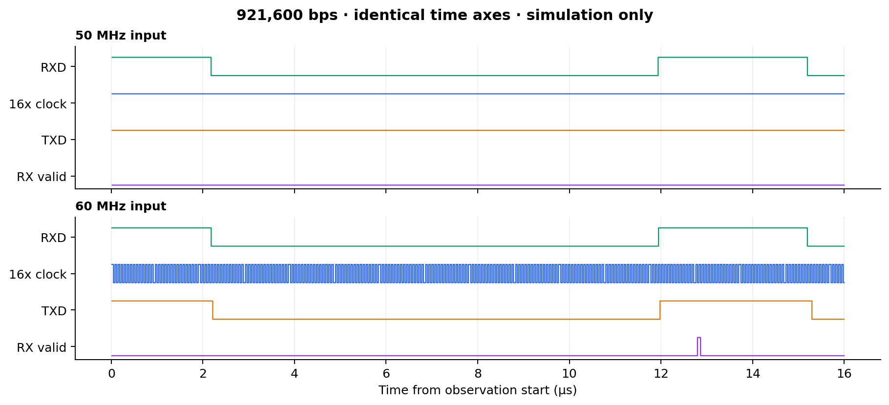
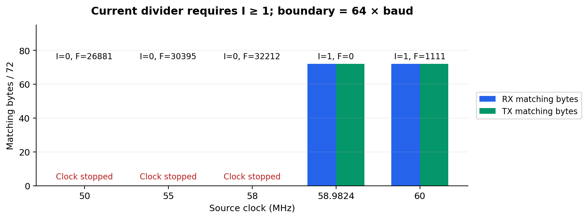

# 921,600 bps 동작을 위한 입력 클록 변경

[README](../../README.md#troubleshooting) · [English](./03-source-clock-frequency.md) · [이전: 소수 분주기의 carry 처리](./02-fractional-divider-carry.ko.md)

## 문제와 원인

Carry 수정 이후 **50 MHz / 921,600 bps** 시뮬레이션에서 다른 동작 한계를 확인했다. 정수 분주 설정값이 0이 되어 오버샘플링 출력의 토글이 멈췄다.

수정한 분주기는 정수 카운터가 0이 아닌 값에서 0으로 전환될 때 출력을 토글한다. `div_int = 0`이면 카운터가 0이 아닌 값으로 바뀌지 않으므로, 출력 토글에 필요한 이벤트가 발생하지 않는다.

## 입력 클록 선택

기존 분주 설정값은 다음 식으로 계산한다.

```text
T = baud × 16 × 2
I = floor(source_clock / T) - 1
F = floor(((source_clock mod T) / source_clock) × 65536)
```

현재 분주기에서 `I ≥ 1`이 되려면 `source_clock ≥ 64 × baud`를 만족해야 한다. 921,600 bps에서 계산상 경계는 **58.9824 MHz**다. 이에 입력 클록을 **60 MHz**로 높였으며, 이때 설정값은 `I = 1`, `F = 1111`이다.

> 설계 비교를 위해 작성·측정한 자료. [RTL, 시험 조건 및 원시 결과](../../UART/experiments/clock_generator/README.md).

<p align="center">
  
</p>

## 시뮬레이션 결과

동일한 carry 수정 RTL을 사용하고, 각 입력 클록에 맞춰 분주 설정값을 다시 계산했다. UART 입력 타이밍은 DUT와 독립적으로 생성했으며, 입력 클록 주기는 실수형으로 계산하고 시뮬레이션 시간 정밀도는 1 ps로 설정했다.

| 입력 클록 (MHz) | I | F | 평균 16× 클록 주기 (ns) | 주파수 오차 | RX 일치 | TX 일치 |
| --- | ---: | ---: | ---: | ---: | ---: | ---: |
| 50 | 0 | 26881 | 출력 정지 | — | 0/72 | 0/72 |
| 55 | 0 | 30395 | 출력 정지 | — | 0/72 | 0/72 |
| 58 | 0 | 32212 | 출력 정지 | — | 0/72 | 0/72 |
| 58.9824 | 1 | 0 | 67.816 | +0.0012% | 72/72 | 72/72 |
| 60 | 1 | 1111 | 67.814 | +0.0049% | 72/72 | 72/72 |

<p align="center">
  
</p>

경계보다 낮은 입력 클록에서는 오버샘플링 클록 에지가 관찰되지 않았다. 기대한 RX 데이터 72바이트가 모두 수신되지 않았고, 첫 TX 요청의 수락을 기다리다 시간 초과가 발생했다. 경계 주파수와 60 MHz에서는 송수신 양방향 모두 **72/72바이트가 일치**했으며, 누락·추가 수신·시간 초과 없이 reset 확인도 통과했다. 10 ms 동안 측정한 평균 출력 주파수 오차는 ±0.1% 이내였다.

이 입력 클록 변경 사례의 검증 범위는 **시뮬레이션**이다. 계산한 경계는 현재 분주기 구현에 해당하며, UART의 일반적인 입력 클록 요구사항이나 FPGA 전체 경로의 타이밍 만족을 의미하지 않는다.
